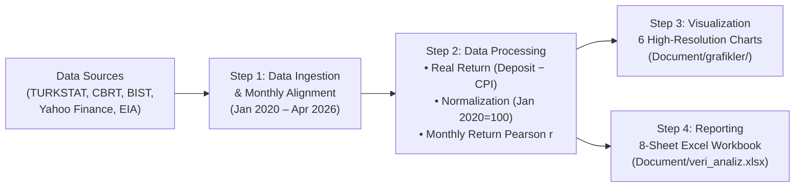

# 📊 Investment Decisions under Uncertainty — IxT 2026 Case Study

[](https://github.com/Uguravsar75/Investment-Decisions-under-Uncertainty/actions/workflows/pipeline-ci.yml)
[](https://www.python.org/)
[](https://pandas.pydata.org/)
[](https://matplotlib.org/)
[](#)
[](LICENSE)

**A 3–5 Year Retail Investment Framework in Türkiye | Macroeconomic Data Pipeline, Asset Correlation Matrix & Scenario-Based Portfolio Strategy (2020–2026)**

This project empirically analyzes multiple macroeconomic and geopolitical shocks in Türkiye between **January 2020 and April 2026**—including the COVID-19 pandemic, currency crisis, Russia–Ukraine energy shock, aggressive monetary tightening cycle, disinflation/normalization, and the 2026 US–Israel–Iran conflict—to build a **profile-sensitive, scenario-driven decision support framework** for individual investors.

> *"In an environment of uncertainty, a resilient investment decision is achieved not by picking the single right asset—but by building the right framework."*

---

## 🗂️ Deliverables & Repository Architecture

| File / Directory | Description |
| :--- | :--- |
| 📄 **[`IxT_2026_Rapor.docx`](IxT_2026_Rapor.docx)** | **Research Report:** Comprehensive 10-chapter case study report featuring 8 analytical tables and 6 high-resolution figures |
| 🖥️ **[`IxT_2026_Sunum.pptx`](IxT_2026_Sunum.pptx)** | **Executive Presentation:** 21-slide presentation deck summarizing macroeconomic findings, correlation structure, and the decision matrix |
| 🐍 **[`Document/analiz_python.py`](Document/analiz_python.py)** | **Data Analysis Pipeline:** End-to-end Python script for data ingestion, normalization, correlation modeling, charting, and Excel export |
| 📊 **[`Document/veri_analiz.xlsx`](Document/veri_analiz.xlsx)** | **Analytical Workbook:** Automatically generated 8-sheet Excel workbook containing verified series and summary tables |
| 🖼️ **[`Document/grafikler/`](Document/grafikler/)** | **Visualizations:** 6 publication-grade charts (`.png`, 150 DPI) embedded across the report and presentation |
| ⚙️ **[`.github/workflows/pipeline-ci.yml`](.github/workflows/pipeline-ci.yml)** | **Continuous Integration (CI):** GitHub Actions workflow that runs the Python pipeline and validates all generated outputs on every push |

```text
├── .github/workflows/
│   └── pipeline-ci.yml              # GitHub Actions automated verification workflow
├── Document/
│   ├── analiz_python.py             # End-to-end data processing & visualization pipeline
│   ├── veri_analiz.xlsx             # 8-sheet verified dataset & analytical outputs
│   └── grafikler/                   # Generated publication-grade charts (Figures 1–6)
│       ├── grafik1_enflasyon_faiz.png
│       ├── grafik2_reel_getiri.png
│       ├── grafik3_normalize_performans.png
│       ├── grafik4_korelasyon.png
│       ├── grafik5_senaryo_profil.png
│       └── grafik6_portfoy.png
├── IxT_2026_Rapor.docx              # Full Research Report (Word)
├── IxT_2026_Sunum.pptx              # 21-Slide Executive Presentation (PowerPoint)
├── Makefile                         # Automation commands for setup, execution & verification
├── requirements.txt                 # Python package dependencies
├── LICENSE                          # MIT License
└── README.md                        # Project documentation
```

---

## 🔄 Analytical Pipeline Architecture



---

## 📌 Key Findings & Empirical Summary (2020–2026)

1. **Time Deposits Alone Failed to Preserve Wealth:** For 4 consecutive years (2020–2023), TRY time deposits yielded negative real returns (averaging **−23.1%**, with the deepest erosion in 2022 at **−59.3%**). Positive real returns only emerged in **2024 (+7.6%)** and **2025 (+9.0%)** following monetary tightening.
2. **Currency Depreciation & Inflation Dynamics:** The USD/TRY exchange rate rose from **5.93 TRY in Jan 2020 to 44.10 TRY in Apr 2026 (+644%)**.
3. **Cumulative Asset Class Performance (Normalized, Jan 2020 = 100):**
   - **Gold (TRY):** `+1,840%` *(All-time global peak in Jan 2026: `5,595 USD/oz`)*
   - **Eurobond (TRY):** `+882%`
   - **BIST100 (Nominal TRY):** `+872%`
   - **USD/TRY:** `+644%`
   - **Real Estate (TRY):** `+562%`
4. **Correlation & Diversification (Monthly Returns, Pearson $r$, 76 Observations):**
   - `USD/TRY × Gold (TRY)` ($r = 0.76$) and `Eurobond (TRY) × Gold (TRY)` ($r = 0.76$) exhibit strong positive correlation driven by the common TRY depreciation channel and **do not provide standalone diversification**.
   - `BIST100 × USD/TRY` ($r = 0.07$), `BIST100 × Real Estate` ($r = 0.09$), and `BIST100 × Gold (TRY)` ($r = 0.14$) exhibit near-zero correlation, providing **structural portfolio diversification**.

### Macroeconomic Indicators Table (Türkiye, 2020–2026)

| Year | CPI Inflation (%) | Policy Rate (%) | Deposit Rate (%) | Real Return (%) | USD/TRY (Year-End) | GDP Growth (%) | Status |
| :--- | :---: | :---: | :---: | :---: | :---: | :---: | :---: |
| **2020** | 14.60 | 10.25 | 12.50 | −2.10 | 7.43 | 1.80 | ✓ Realized |
| **2021** | 19.60 | 14.00 | 15.50 | −4.10 | 13.32 | 11.40 | ✓ Realized |
| **2022** | 72.31 | 9.00 | 13.00 | −59.31 | 18.72 | 5.51 | ✓ Realized |
| **2023** | 64.77 | 42.50 | 38.00 | −26.77 | 29.51 | 4.53 | ✓ Realized |
| **2024** | 44.38 | 47.50 | 52.00 | +7.62 | 35.20 | 3.20 | ✓ Realized |
| **2025** | 26.00 | 38.00 | 35.00 | +9.00 | 38.90 | 2.60 | ✓ Year-End |
| **2026*** | 30.87 | 37.00 | 32.00 | +1.13 | 44.10 | 2.80 | † Q1 + Forecast |

---

## 📈 Generated Visualizations

### 1. CPI Inflation, CBRT Policy Rate & Deposit Rate (2020–2026)


### 2. Real Return on TRY Time Deposits (Deposit Rate − CPI)


### 3. Normalized Asset Class Performance (Jan 2020 = 100)


### 4. Asset Correlation Matrix (Monthly Returns, 2020–2026)


### 5. Scenario × Investor Profile Decision Matrix


### 6. Profile-Based Illustrative Portfolio Allocations


---

## 🚀 Quick Start & Execution

### 1. Set Up the Environment

```bash
python3 -m venv .venv
source .venv/bin/activate  # On Windows: .venv\Scripts\activate
pip install -r requirements.txt
```

*(Alternatively, use the `Makefile`: `make setup`)*

### 2. Run the Analysis Pipeline

```bash
python3 Document/analiz_python.py
# or
make verify
```

Running the script will:
- Regenerate all 6 high-resolution charts (`.png`) inside `Document/grafikler/`.
- Export the 8-sheet analytical Excel workbook to `Document/veri_analiz.xlsx` (`Yillik_Gostergeler`, `Aylik_Piyasa`, `Normalize_Performans`, `Korelasyon_Matrisi`, `Reel_Getiri_Ozeti`, `Korelasyon_Aciklamasi`, `Iran_Savasi_Enerji`, `Portfoy_Dagilim`).
- Switch data source modes via the `DATA_SOURCE_MODE` parameter (`"sunum"`, `"excel"`, `"live"`) in `Document/analiz_python.py`.

---

## 📚 Data Sources

- **TURKSTAT (TÜİK):** Consumer Price Index (CPI) and GDP growth series (`data.tuik.gov.tr`)
- **CBRT (TCMB):** One-week repo policy rate, weighted average deposit rates, and FX series (`tcmb.gov.tr`)
- **Borsa Istanbul (BIST) & Yahoo Finance:** `XU100.IS`, `GC=F` (Gold Spot USD/oz), `USDTRY=X`
- **IMF & World Bank:** *World Economic Outlook* & *Global Economic Prospects* projections for Türkiye
- **EIA & LBMA:** Brent crude oil, TTF natural gas, and London Bullion Market gold spot series

---

## 📄 License

This project is licensed under the [MIT License](LICENSE).
