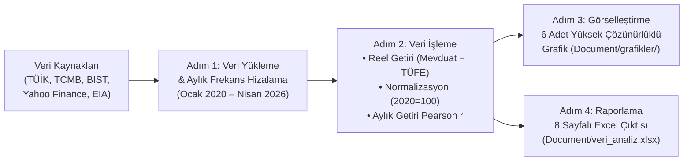
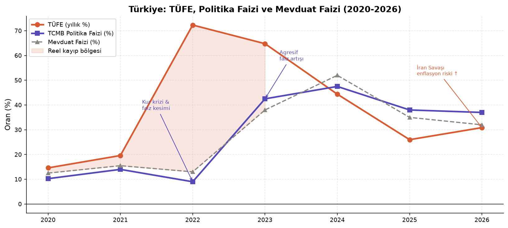
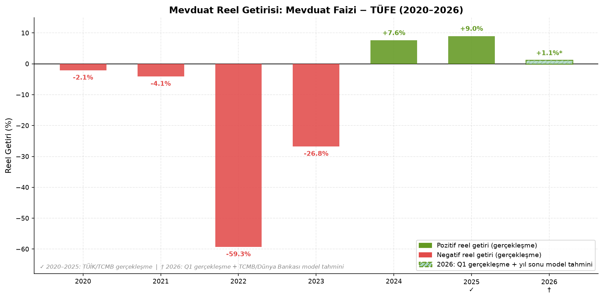
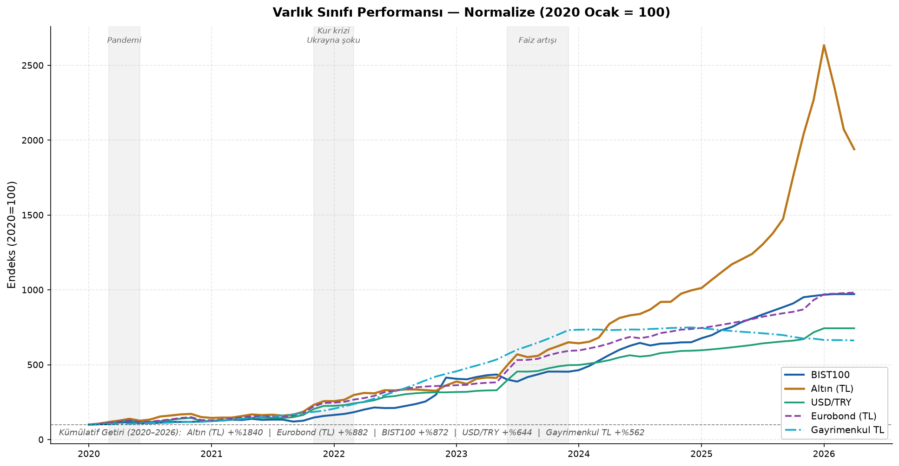
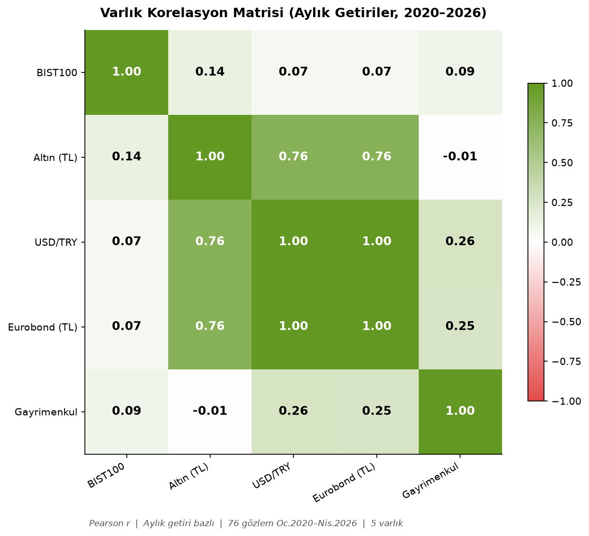
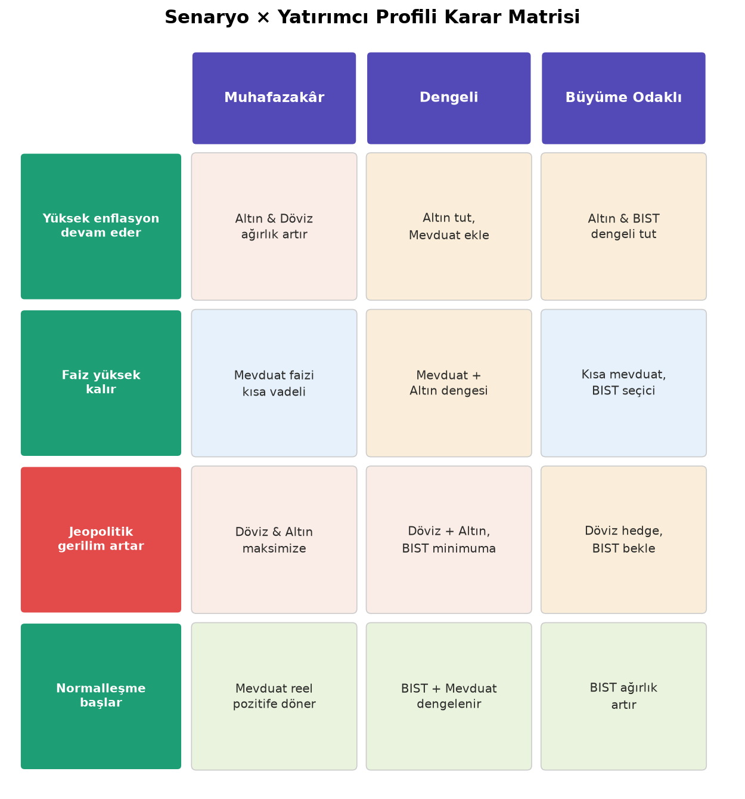
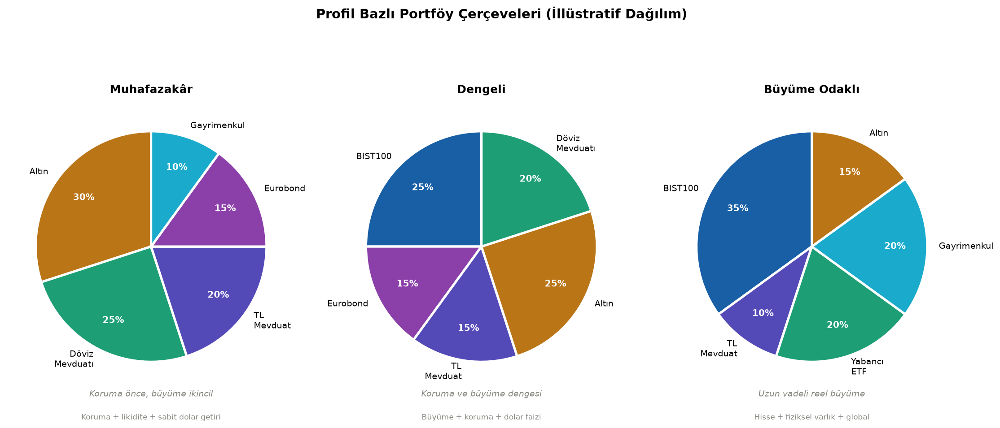

# 📊 IxT 2026 Case Study — Belirsizlik Ortamında Bireysel Yatırım Kararları

[](https://github.com/Uguravsar75/belirsizlik-ortaminda-yatirim-kararlari/actions/workflows/pipeline-ci.yml)
[](https://www.python.org/)
[](https://pandas.pydata.org/)
[](https://matplotlib.org/)
[](#)
[](LICENSE)

**Türkiye'de 3–5 Yıllık Yatırım Çerçevesi | Makroekonomik Veri Analizi, Korelasyon Matrisi ve Portföy Stratejisi Pipeline'ı**

Bu proje, Türkiye'de **Ocak 2020 – Nisan 2026** döneminde yaşanan çoklu makroekonomik ve jeopolitik şokları (pandemi, kur krizi, Rusya–Ukrayna enerji şoku, agresif faiz artış döngüsü, dezenflasyon/normalleşme ve 2026 ABD–İsrail–İran savaşı) veriyle belgeleyerek bireysel yatırımcılar için **profil duyarlı ve senaryo tabanlı bir karar destek çerçevesi** sunar.

> *"Belirsizlik ortamında güçlü bir yatırım kararı, doğru varlığı bulmakla değil — doğru çerçeveyi kurmakla mümkündür."*

---

## 🗂️ Teslimatlar ve Proje Mimarisi

| Dosya / Klasör | Açıklama |
| :--- | :--- |
| 📄 **[`IxT_2026_Rapor.docx`](IxT_2026_Rapor.docx)** | **Araştırma Raporu:** 10 bölüm, 8 tablo ve 6 yüksek çözünürlüklü şekilden oluşan kapsamlı vaka analizi raporu |
| 🖥️ **[`IxT_2026_Sunum.pptx`](IxT_2026_Sunum.pptx)** | **Yönetici Sunumu:** Bulguları, korelasyon analizini ve karar matrisini özetleyen 21 slaytlık sunum |
| 🐍 **[`Document/analiz_python.py`](Document/analiz_python.py)** | **Veri Pipeline'ı:** Verileri işleyen, normalizasyon/korelasyon hesaplarını yapan ve tüm çıktıları üreten Python betiği |
| 📊 **[`Document/veri_analiz.xlsx`](Document/veri_analiz.xlsx)** | **Analiz Çalışma Kitabı:** Pipeline tarafından otomatik üretilen 8 sayfalı doğrulanmış Excel veri seti |
| 🖼️ **[`Document/grafikler/`](Document/grafikler/)** | **Görselleştirmeler:** Rapor ve sunumda kullanılan 6 adet yayın kalitesinde (`.png`, 150 DPI) grafik |
| ⚙️ **[`.github/workflows/pipeline-ci.yml`](.github/workflows/pipeline-ci.yml)** | **Sürekli Entegrasyon (CI):** Her kod güncellemesinde pipeline'ı çalıştırıp çıktıları doğrulayan GitHub Actions iş akışı |

```text
├── .github/workflows/
│   └── pipeline-ci.yml              # GitHub Actions otomatik doğrulama iş akışı
├── Document/
│   ├── analiz_python.py             # Uçtan uca veri işleme ve görselleştirme pipeline'ı
│   ├── veri_analiz.xlsx             # 8 sayfalı doğrulanmış veri seti ve analiz çıktıları
│   └── grafikler/                   # Pipeline tarafından üretilen grafikler (Şekil 1–6)
│       ├── grafik1_enflasyon_faiz.png
│       ├── grafik2_reel_getiri.png
│       ├── grafik3_normalize_performans.png
│       ├── grafik4_korelasyon.png
│       ├── grafik5_senaryo_profil.png
│       └── grafik6_portfoy.png
├── IxT_2026_Rapor.docx              # Kapsamlı Araştırma Raporu
├── IxT_2026_Sunum.pptx              # 21 Slaytlık Yönetici Sunumu
├── Makefile                         # Kurulum ve çalıştırma otomasyon komutları
├── requirements.txt                 # Python paket bağımlılıkları
├── LICENSE                          # MIT Lisansı
└── README.md                        # Proje dokümantasyonu
```

---

## 🔄 Analitik Pipeline Akışı



---

## 📌 Temel Bulgular ve Veri Özeti (2020–2026)

1. **Mevduat Tek Başına Serveti Korumadı:** 2020–2023 arasındaki 4 yıl boyunca TL mevduat kesintisiz negatif reel getiri sağladı (dönem ortalaması **−%23,1**, en derin kayıp 2022'de **−%59,3**). İlk pozitif reel getiri **2024 (+%7,6)** ve **2025 (+%9,0)** yıllarında kaydedildi.
2. **Kur ve Enflasyon Kıskacı:** USD/TRY kuru Ocak 2020 – Nisan 2026 arasında **5,93 TL'den 44,10 TL'ye (+%644)** yükseldi.
3. **Varlık Sınıfı Performansı (Ocak 2020 = 100):**
   - **Altın (TL):** `+%1.840` *(Ocak 2026 ons zirvesi: `5.595 USD/ons`)*
   - **Eurobond (TL):** `+%882`
   - **BIST100 (Nominal TL):** `+%872`
   - **USD/TRY:** `+%644`
   - **Gayrimenkul (TL):** `+%562`
4. **Korelasyon ve Çeşitlendirme (Aylık Getiri Bazlı Pearson $r$, 76 Gözlem):**
   - `USD/TRY × Altın (TL)` ($r = 0,76$) ve `Eurobond (TL) × Altın (TL)` ($r = 0,76$) çiftleri aynı kur kanalından beslendiği için **tek başına çeşitlendirme sağlamaz**.
   - `BIST100 × USD/TRY` ($r = 0,07$), `BIST100 × Gayrimenkul` ($r = 0,09$) ve `BIST100 × Altın (TL)` ($r = 0,14$) çiftleri düşük korelasyonlarıyla **gerçek portföy çeşitlendirmesi** üretir.

### Türkiye Makroekonomik Göstergeler Tablosu (2020–2026)

| Yıl | TÜFE (%) | Politika Faizi (%) | Mevduat Faizi (%) | Reel Getiri (%) | USD/TRY (Yıl Sonu) | GSYİH Büyüme (%) | Durum |
| :--- | :---: | :---: | :---: | :---: | :---: | :---: | :---: |
| **2020** | 14,60 | 10,25 | 12,50 | −2,10 | 7,43 | 1,80 | ✓ Gerçekleşme |
| **2021** | 19,60 | 14,00 | 15,50 | −4,10 | 13,32 | 11,40 | ✓ Gerçekleşme |
| **2022** | 72,31 | 9,00 | 13,00 | −59,31 | 18,72 | 5,51 | ✓ Gerçekleşme |
| **2023** | 64,77 | 42,50 | 38,00 | −26,77 | 29,51 | 4,53 | ✓ Gerçekleşme |
| **2024** | 44,38 | 47,50 | 52,00 | +7,62 | 35,20 | 3,20 | ✓ Gerçekleşme |
| **2025** | 26,00 | 38,00 | 35,00 | +9,00 | 38,90 | 2,60 | ✓ Yıl Sonu |
| **2026*** | 30,87 | 37,00 | 32,00 | +1,13 | 44,10 | 2,80 | † Q1 + Tahmin |

---

## 📈 Üretilen Grafikler

### 1. Enflasyon, Politika Faizi ve Mevduat Faizi (2020–2026)


### 2. Mevduat Reel Getirisi (Mevduat Faizi − TÜFE)


### 3. Normalize Varlık Sınıfı Performansı (2020 Ocak = 100)


### 4. Varlık Korelasyon Matrisi (Aylık Getiriler, 2020–2026)


### 5. Senaryo × Yatırımcı Profili Karar Matrisi


### 6. Profil Bazlı Portföy Çerçeveleri (İllüstratif Dağılım)


---

## 🚀 Kurulum ve Çalıştırma

### 1. Ortamı Hazırlayın

```bash
python3 -m venv .venv
source .venv/bin/activate  # Windows için: .venv\Scripts\activate
pip install -r requirements.txt
```

*(Alternatif olarak `Makefile` kullanabilirsiniz: `make setup`)*

### 2. Analiz Pipeline'ını Çalıştırın

```bash
python3 Document/analiz_python.py
# veya
make verify
```

Betik çalıştırıldığında:
- `Document/grafikler/` klasörü altındaki 6 grafiği yüksek çözünürlüklü (`.png`) olarak yeniden üretir.
- `Document/veri_analiz.xlsx` dosyasını 8 ayrı çalışma sayfasıyla (`Yillik_Gostergeler`, `Aylik_Piyasa`, `Normalize_Performans`, `Korelasyon_Matrisi`, `Reel_Getiri_Ozeti`, `Korelasyon_Aciklamasi`, `Iran_Savasi_Enerji`, `Portfoy_Dagilim`) günceller.
- Veri kaynağı modu `Document/analiz_python.py` içindeki `DATA_SOURCE_MODE` değişkeniyle (`"sunum"`, `"excel"`, `"live"`) değiştirilebilir.

---

## 📚 Veri Kaynakları

- **TÜİK:** Tüketici Fiyat Endeksi (TÜFE) ve GSYİH büyüme serileri (`data.tuik.gov.tr`)
- **TCMB:** Politika faizi, ağırlıklı ortalama mevduat faizleri ve döviz kurları (`tcmb.gov.tr`)
- **Borsa İstanbul (BIST) & Yahoo Finance:** `XU100.IS`, `GC=F` (Ons Altın), `USDTRY=X`
- **IMF & Dünya Bankası:** *World Economic Outlook* & *Global Economic Prospects* Türkiye projeksiyonları
- **EIA & LBMA:** Brent ham petrol, TTF doğal gaz ve altın spot fiyat serileri

---

## 📄 Lisans

Bu proje [MIT Lisansı](LICENSE) altında lisanslanmıştır.
