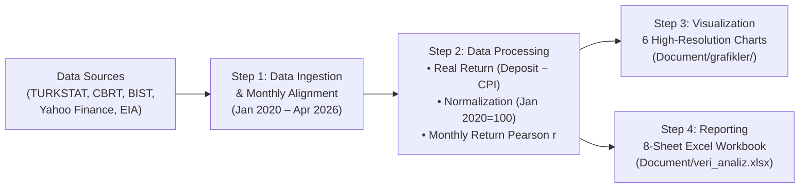
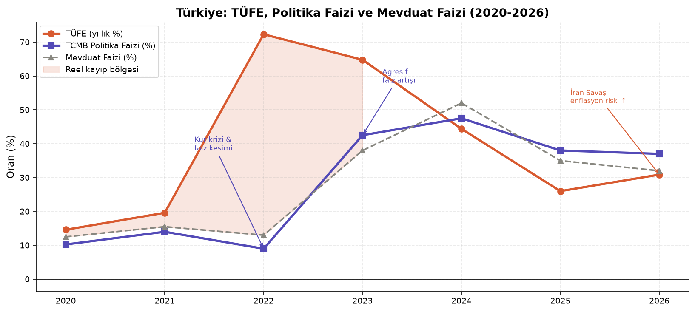
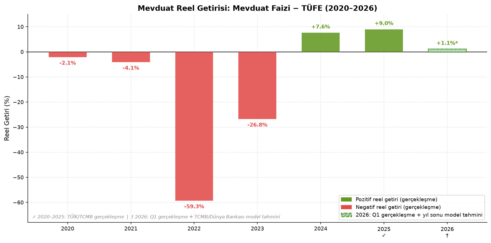
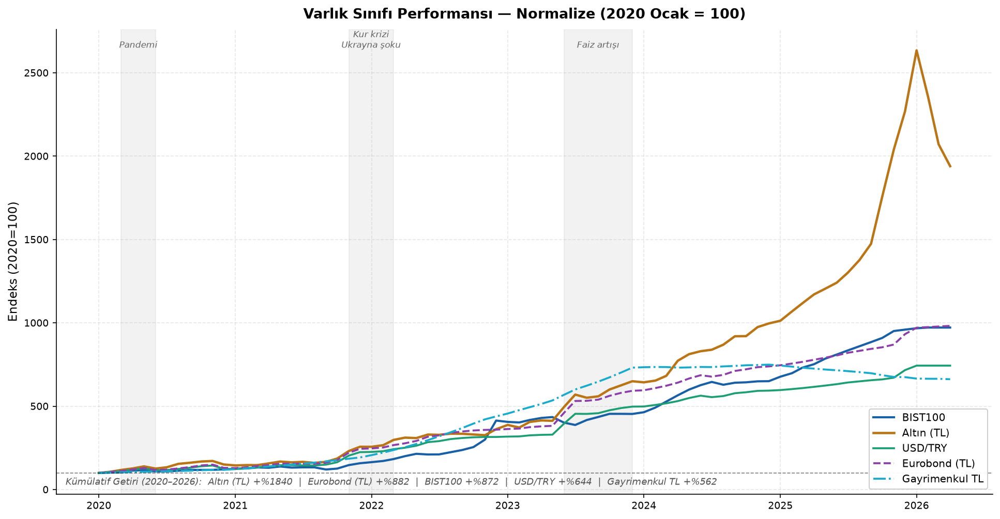
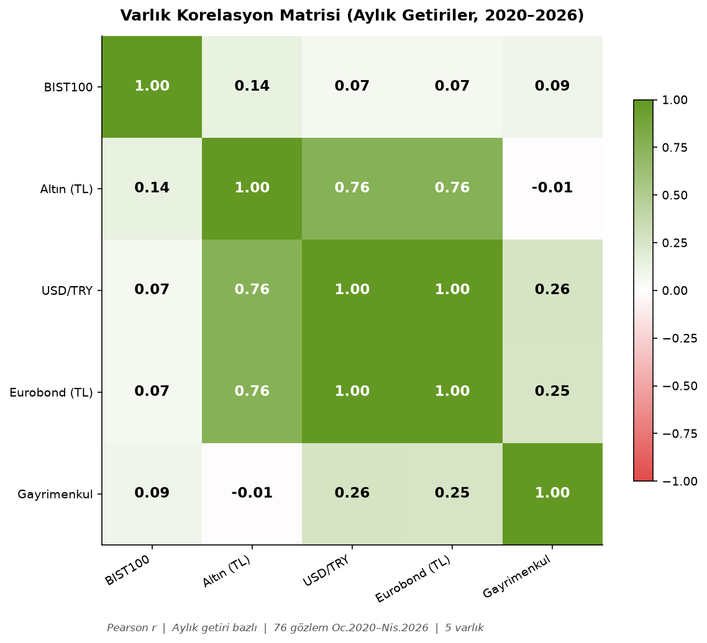
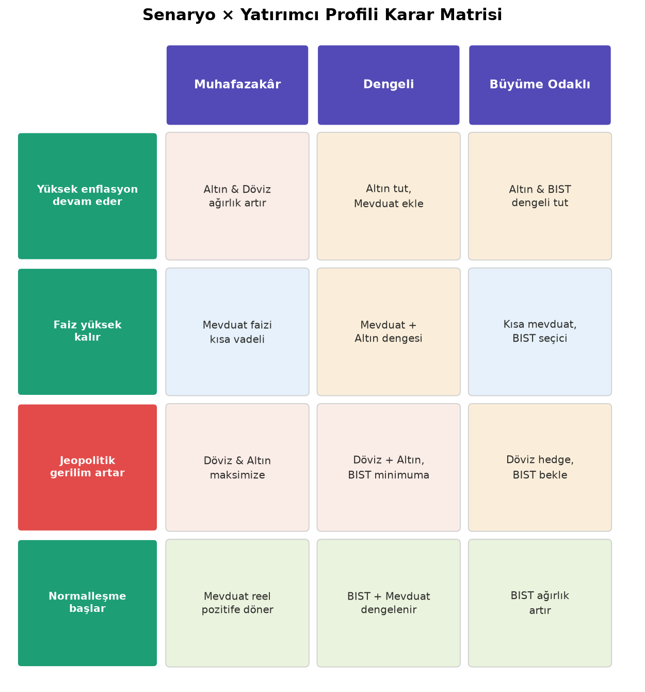
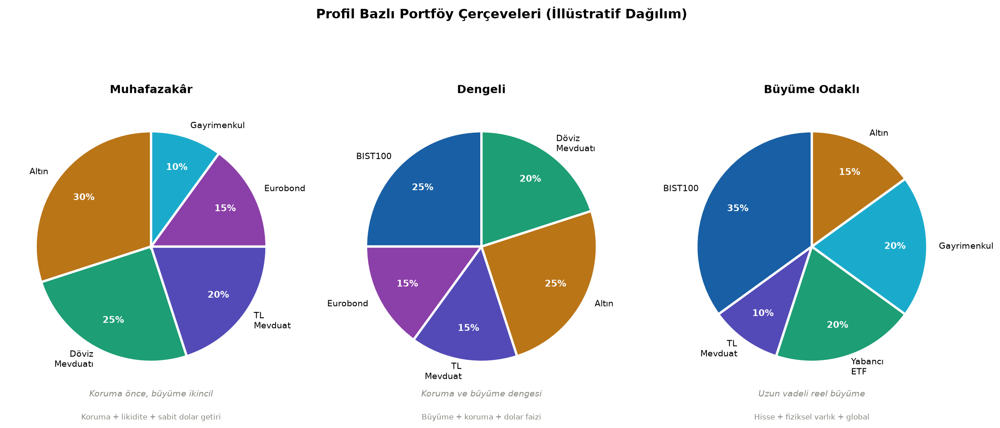

# 📊 Belirsizlik Altında Yatırım Kararları — IxT 2026 Vaka Çalışması

[](https://github.com/Uguravsar75/Investment-Decisions-under-Uncertainty/actions/workflows/pipeline-ci.yml)
[](https://www.python.org/)
[](https://pandas.pydata.org/)
[](https://matplotlib.org/)
[](#)
[](LICENSE)

[English](README.md) | **Türkçe**

**Türkiye'de Bireysel Yatırımcı İçin 3–5 Yıllık Yatırım Çerçevesi | Makroekonomik Veri Hattı, Varlık Korelasyon Matrisi ve Senaryo Bazlı Portföy Stratejisi (2020–2026)**

Bu proje, Türkiye'nin **Ocak 2020 – Nisan 2026** arasında yaşadığı makroekonomik ve jeopolitik şokları veriyle inceliyor: COVID-19 salgını, kur krizi, Rusya–Ukrayna enerji şoku, sert parasal sıkılaştırma dönemi, dezenflasyon ve normalleşme, ve 2026 ABD–İsrail–İran çatışması. Amaç, bireysel yatırımcılar için **yatırımcı profiline duyarlı, senaryo temelli bir karar destek çerçevesi** kurmak.

> *"Belirsizlik ortamında dayanıklı bir yatırım kararı, tek doğru varlığı seçmekle değil, doğru çerçeveyi kurmakla elde edilir."*

---

## 🗂️ Çıktılar ve Repo Yapısı

| Dosya / Klasör | Açıklama |
| :--- | :--- |
| 📄 **[`IxT_2026_Rapor.docx`](IxT_2026_Rapor.docx)** | **Araştırma raporu:** 8 analitik tablo ve 6 yüksek çözünürlüklü grafik içeren 10 bölümlük kapsamlı vaka çalışması raporu |
| 🖥️ **[`IxT_2026_Sunum.pptx`](IxT_2026_Sunum.pptx)** | **Yönetici sunumu:** Makroekonomik bulguları, korelasyon yapısını ve karar matrisini özetleyen 21 slaytlık sunum |
| 🐍 **[`Document/analiz_python.py`](Document/analiz_python.py)** | **Veri analizi hattı:** Veri alma, normalleştirme, korelasyon modelleme, grafik üretme ve Excel'e aktarma işlerini baştan sona yapan Python scripti |
| 📊 **[`Document/veri_analiz.xlsx`](Document/veri_analiz.xlsx)** | **Analiz çalışma kitabı:** Doğrulanmış seriler ve özet tablolarla otomatik üretilen 8 sayfalık Excel dosyası |
| 🖼️ **[`Document/grafikler/`](Document/grafikler/)** | **Görseller:** Rapora ve sunuma yerleştirilen 6 yayın kalitesinde grafik (`.png`, 150 DPI) |
| ⚙️ **[`.github/workflows/pipeline-ci.yml`](.github/workflows/pipeline-ci.yml)** | **Sürekli entegrasyon (CI):** Her push'ta Python hattını çalıştırıp tüm çıktıları doğrulayan GitHub Actions iş akışı |

```text
├── .github/workflows/
│   └── pipeline-ci.yml              # GitHub Actions otomatik doğrulama iş akışı
├── Document/
│   ├── analiz_python.py             # Baştan sona veri işleme ve görselleştirme hattı
│   ├── veri_analiz.xlsx             # 8 sayfalık doğrulanmış veri seti ve analiz çıktıları
│   └── grafikler/                   # Üretilen yayın kalitesinde grafikler (Şekil 1–6)
│       ├── grafik1_enflasyon_faiz.png
│       ├── grafik2_reel_getiri.png
│       ├── grafik3_normalize_performans.png
│       ├── grafik4_korelasyon.png
│       ├── grafik5_senaryo_profil.png
│       └── grafik6_portfoy.png
├── IxT_2026_Rapor.docx              # Tam araştırma raporu (Word)
├── IxT_2026_Sunum.pptx              # 21 slaytlık yönetici sunumu (PowerPoint)
├── Makefile                         # Kurulum, çalıştırma ve doğrulama komutları
├── requirements.txt                 # Python paket bağımlılıkları
├── LICENSE                          # MIT Lisansı
├── README.md                        # İngilizce dokümantasyon
└── README.tr.md                     # Türkçe dokümantasyon
```

---

## 🔄 Analiz Hattının Yapısı



---

## 📌 Temel Bulgular (2020–2026)

1. **Vadeli mevduat tek başına birikimi koruyamadı:** TL vadeli mevduat 4 yıl üst üste (2020–2023) negatif reel getiri sağladı (ortalama **−%23,1**; en derin kayıp 2022'de **−%59,3**). Pozitif reel getiri ancak parasal sıkılaştırmadan sonra, **2024'te (+%7,6)** ve **2025'te (+%9,0)** görüldü.
2. **Kur ve enflasyon dinamikleri:** USD/TRY kuru **Ocak 2020'de 5,93 TL iken Nisan 2026'da 44,10 TL'ye (+%644)** çıktı.
3. **Varlık sınıflarının kümülatif performansı (normalleştirilmiş, Ocak 2020 = 100):**
   - **Altın (TL):** `+%1.840` *(Ocak 2026'da küresel rekor: `5.595 USD/ons`)*
   - **Eurobond (TL):** `+%882`
   - **BIST100 (nominal TL):** `+%872`
   - **USD/TRY:** `+%644`
   - **Gayrimenkul (TL):** `+%562`
4. **Korelasyon ve çeşitlendirme (aylık getiriler, Pearson $r$, 76 gözlem):**
   - `USD/TRY × Altın (TL)` ($r = 0,76$) ve `Eurobond (TL) × Altın (TL)` ($r = 0,76$) arasında, ortak TL değer kaybı kanalı nedeniyle güçlü pozitif korelasyon var; bu varlıklar **kendi başlarına çeşitlendirme sağlamıyor**.
   - `BIST100 × USD/TRY` ($r = 0,07$), `BIST100 × Gayrimenkul` ($r = 0,09$) ve `BIST100 × Altın (TL)` ($r = 0,14$) arasındaki korelasyon sıfıra yakın; bu da **yapısal portföy çeşitlendirmesi** sağlıyor.

### Makroekonomik Göstergeler Tablosu (Türkiye, 2020–2026)

| Yıl | TÜFE Enflasyonu (%) | Politika Faizi (%) | Mevduat Faizi (%) | Reel Getiri (%) | USD/TRY (Yıl Sonu) | GSYH Büyümesi (%) | Durum |
| :--- | :---: | :---: | :---: | :---: | :---: | :---: | :---: |
| **2020** | 14,60 | 10,25 | 12,50 | −2,10 | 7,43 | 1,80 | ✓ Gerçekleşen |
| **2021** | 19,60 | 14,00 | 15,50 | −4,10 | 13,32 | 11,40 | ✓ Gerçekleşen |
| **2022** | 72,31 | 9,00 | 13,00 | −59,31 | 18,72 | 5,51 | ✓ Gerçekleşen |
| **2023** | 64,77 | 42,50 | 38,00 | −26,77 | 29,51 | 4,53 | ✓ Gerçekleşen |
| **2024** | 44,38 | 47,50 | 52,00 | +7,62 | 35,20 | 3,20 | ✓ Gerçekleşen |
| **2025** | 26,00 | 38,00 | 35,00 | +9,00 | 38,90 | 2,60 | ✓ Yıl sonu |
| **2026*** | 30,87 | 37,00 | 32,00 | +1,13 | 44,10 | 2,80 | † 1. çeyrek + tahmin |

---

## 📈 Üretilen Grafikler

### 1. TÜFE Enflasyonu, TCMB Politika Faizi ve Mevduat Faizi (2020–2026)


### 2. TL Vadeli Mevduatın Reel Getirisi (Mevduat Faizi − TÜFE)


### 3. Varlık Sınıflarının Normalleştirilmiş Performansı (Ocak 2020 = 100)


### 4. Varlık Korelasyon Matrisi (Aylık Getiriler, 2020–2026)


### 5. Senaryo × Yatırımcı Profili Karar Matrisi


### 6. Profile Göre Örnek Portföy Dağılımları


---

## 🚀 Hızlı Başlangıç

### 1. Ortamı kurun

```bash
python3 -m venv .venv
source .venv/bin/activate  # Windows'ta: .venv\Scripts\activate
pip install -r requirements.txt
```

*(Ya da `Makefile` ile: `make setup`)*

### 2. Analiz hattını çalıştırın

```bash
python3 Document/analiz_python.py
# veya
make verify
```

Script çalışınca:
- 6 yüksek çözünürlüklü grafiğin (`.png`) hepsini `Document/grafikler/` klasöründe yeniden üretir.
- 8 sayfalık analiz Excel dosyasını `Document/veri_analiz.xlsx` olarak dışa aktarır (`Yillik_Gostergeler`, `Aylik_Piyasa`, `Normalize_Performans`, `Korelasyon_Matrisi`, `Reel_Getiri_Ozeti`, `Korelasyon_Aciklamasi`, `Iran_Savasi_Enerji`, `Portfoy_Dagilim`).
- Veri kaynağı modu, `Document/analiz_python.py` içindeki `DATA_SOURCE_MODE` parametresiyle değiştirilebilir (`"sunum"`, `"excel"`, `"live"`).

---

## 📚 Veri Kaynakları

- **TÜİK:** Tüketici Fiyat Endeksi (TÜFE) ve GSYH büyüme serileri (`data.tuik.gov.tr`)
- **TCMB:** Bir haftalık repo politika faizi, ağırlıklı ortalama mevduat faizleri ve döviz serileri (`tcmb.gov.tr`)
- **Borsa İstanbul (BIST) ve Yahoo Finance:** `XU100.IS`, `GC=F` (spot altın, USD/ons), `USDTRY=X`
- **IMF ve Dünya Bankası:** Türkiye için *World Economic Outlook* ve *Global Economic Prospects* projeksiyonları
- **EIA ve LBMA:** Brent petrol, TTF doğal gaz ve Londra Külçe Piyasası spot altın serileri

---

## 📄 Lisans

Bu proje [MIT Lisansı](LICENSE) ile lisanslanmıştır.
